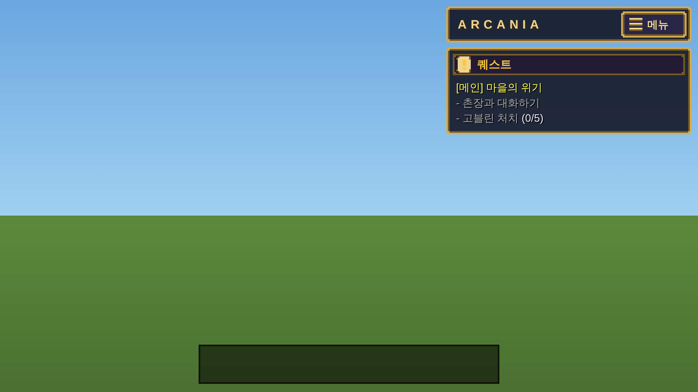

# Arcania RPG (Minecraft Bedrock 애드온)

바닐라 마크 UI를 완전히 다른 RPG 느낌으로 바꾸고, RPG 시스템 전체를 추가하는 리소스팩 + 비헤이비어팩.



## 설치
`dist/Arcania_RPG_UI.mcaddon` 을 열면 두 팩이 같이 설치된다. 월드 설정에서 **리소스팩과 비헤이비어팩 둘 다** 켤 것.
최소 버전: 1.21.50 (`@minecraft/server` 1.16.0, `@minecraft/server-ui` 1.3.0)

## 플레이어 기능
| 기능 | 내용 |
|---|---|
| **HUD 버튼** | 오른쪽 위 **[메뉴] / [스킬]** 버튼. 실제로는 핫바 9번/8번 칸을 선택하는 버튼이라, 스크립트가 감지해 메뉴를 열거나 스킬을 쓰고 원래 칸으로 되돌림. PC는 숫자키 **9 / 8** (설정에서 끌 수 있음) |
| **메뉴북 / 스킬 아이템** | 9번·8번 칸에 고정 지급. 직접 사용해도 메뉴/스킬 |
| **메뉴 화면** | 왼쪽 탭 레일 + 가운데 목록/그리드 + 오른쪽 상세 카드 + 상단 재화/닫기. 바닐라 폼 모양이 아니다 |
| **배낭** | 분류 탭(전체/무기/방어구/소모품/재료/기타), 희귀도별 칸 색, 상세 카드(공격력·방어력·내구도·인챈트), 장착/해제/손에 들기/버리기/정렬 |
| **직업** | 전사·궁수·마법사·성직자. 직업마다 기본 스탯과 성장치, 고유 스킬이 다름. 첫 선택은 무료, 전직은 500G |
| **레벨/스탯** | 몹 처치로 경험치·골드 획득. 레벨업 시 스탯 포인트 3. 힘=피해, 민첩=치명타·이속, 지능=마법·쿨감, 체력=최대 체력 |
| **파티** | 파티 생성, 모집 게시판(공개/자유가입/승인제/최소 레벨), 가입 신청과 승인, 초대, 추방, 위임, 탈퇴, 해산. 근처 파티원끼리 경험치 40%와 처치 퀘스트 진행 공유, HUD에 파티원 체력 표시 |
| **퀘스트** | 게시판 퀘스트와 NPC 퀘스트. 목표는 처치/수집/방문/대화. 선행 퀘스트, 레벨·직업 제한, 반복 가능. HUD 추적(최대 3개) |
| **상점** | 골드로 구매, 개당 가격의 30%로 판매. NPC마다 전용 상품 목록 가능 |
| **채팅** | 전체 채팅, 파티 채팅, 채팅방(비밀번호 가능), 1:1 대화. 안 읽은 메시지가 HUD에 표시됨 |
| **NPC 대화** | 화면 아래 이름+대사, 오른쪽 선택지. 대사 여러 페이지, 퀘스트·상점·사용자 선택지(답변/명령어) |
| **HUD** | 왼쪽 위 캐릭터 카드(레벨/경험치/골드/스킬 쿨/파티), 오른쪽 위 메뉴바와 퀘스트창 |
| **테마** | 바닐라 인벤토리·상자·폼의 배경, 슬롯, 탭, 핫바 텍스처를 같은 테마로 교체 |

## 제작자 도구
1. 권한: `/tag @s add rpg_admin`
2. 도구 받기: `/give @s rpg:quest_tool` (또는 메뉴 → 제작자 도구)

| 탭 | 기능 |
|---|---|
| 퀘스트 | **빠른 생성**(한 화면), 상세 생성 마법사, 기본 정보·목표·보상 편집, 복제, 활성/비활성, 나에게 테스트 부여, 삭제 |
| NPC | 소환, 외형 12종(스티브/알렉스/기사/상인/마법사/성직자/대장장이/경비병/사용자 스킨 4칸), 대사(최대 5페이지), 대화 선택지(답변/명령어), 전용 상점, 이동, 제거. **도구를 들고 NPC를 누르면 바로 관리** |
| 상점 | 손에 든 아이템 등록, 가격·수량 편집, 순서 변경, 삭제 |
| 플레이어 | 경험치·골드 지급, 레벨·퀘스트 초기화, 관리자 권한 부여 |
| 데이터 | 퀘스트 JSON 내보내기/가져오기, **다른 애드온 아이템 아이콘 지정** |

**자동 입력 편의 기능:** 목표를 추가할 때 처치 대상은 **바라보던 몹**, 수집 대상은 **손에 든 아이템**, 방문 목표는 **현재 좌표**가 자동으로 채워진다. 보상에도 손에 든 아이템을 한 번에 추가할 수 있다.

## 커맨드 연동 (`/scriptevent`)
```
/scriptevent rpg:menu                 메뉴 열기
/scriptevent rpg:quests               퀘스트 화면
/scriptevent rpg:admin                제작자 도구
/scriptevent rpg:give_quest main_1    퀘스트 부여
/scriptevent rpg:quest 텍스트\n둘째줄  퀘스트창에 임의 텍스트 (빈 값이면 원래대로)
```

## 구조
```
resource_pack/
  ui/rpg_form.json        메뉴 화면 레이아웃 (서버 폼을 [RPG:G/H/L] 플래그로 재배치)
  ui/server_form.json     서버 폼 → RPG 라우터
  ui/rpg_hud.json         HUD 메뉴바, 퀘스트창, 캐릭터 카드
  ui/hud_screen.json      HUD 삽입, 전용 title/actionbar 숨김
  textures/ui/rpg/        RPG 텍스처 (gen_textures.py 로 생성)
  textures/ui/*.png       바닐라 UI 텍스처 덮어쓰기 (테마)
  entity/, render_controllers/  NPC
behavior_pack/scripts/
  main.js 이벤트 / menu.js 플레이어 화면 / admin.js 제작자 도구 / ui.js 화면 빌더
  quests.js 퀘스트 엔진 / party.js 파티 / combat.js 전투·스킬 / player.js 데이터
  classes.js 직업 / shop.js 상점 / hud.js HUD / itemdb.js 아이템 정보 / texmap.js 아이콘 표
```
- 색 변경: `gen_textures.py` 의 `PALETTE` 수정 → `python gen_textures.py`
- 아이콘 표 갱신(마크 업데이트 후): `python gen_texmap.py`

## NPC 사용자 스킨
`resource_pack/textures/entity/rpg_npc/custom_1.png` ~ `custom_4.png` 를 원하는 64x64 스킨(와이드 팔)으로 바꾸면 외형 목록의 "사용자 스킨 1~4" 에 적용된다.

## 알려진 제약
- 다른 애드온 아이템 아이콘은 `textures/items/<아이템 이름>` 으로 추정한다. 안 맞으면 제작자 도구 > 데이터 > 아이콘 지정.
- 실제 인벤토리(E키)는 드래그·드롭 동작을 지키려고 레이아웃은 그대로 두고 **테마만** 바꿨다. 사진 같은 배치는 메뉴의 **배낭**에서 볼 수 있다.
